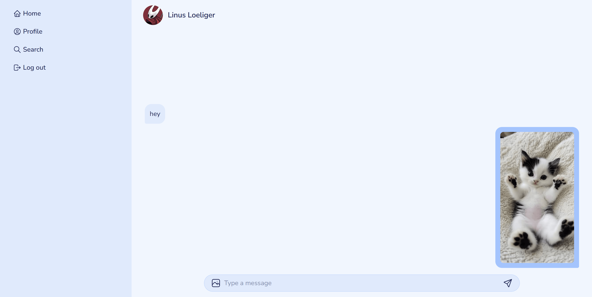
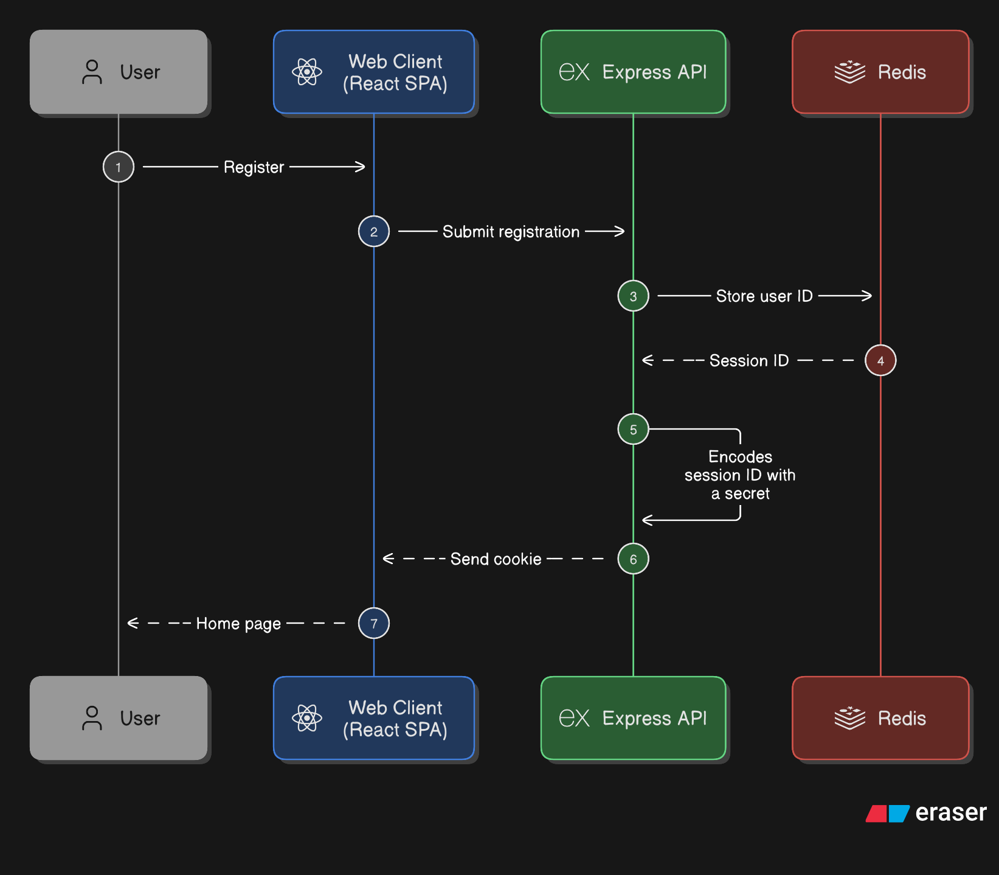
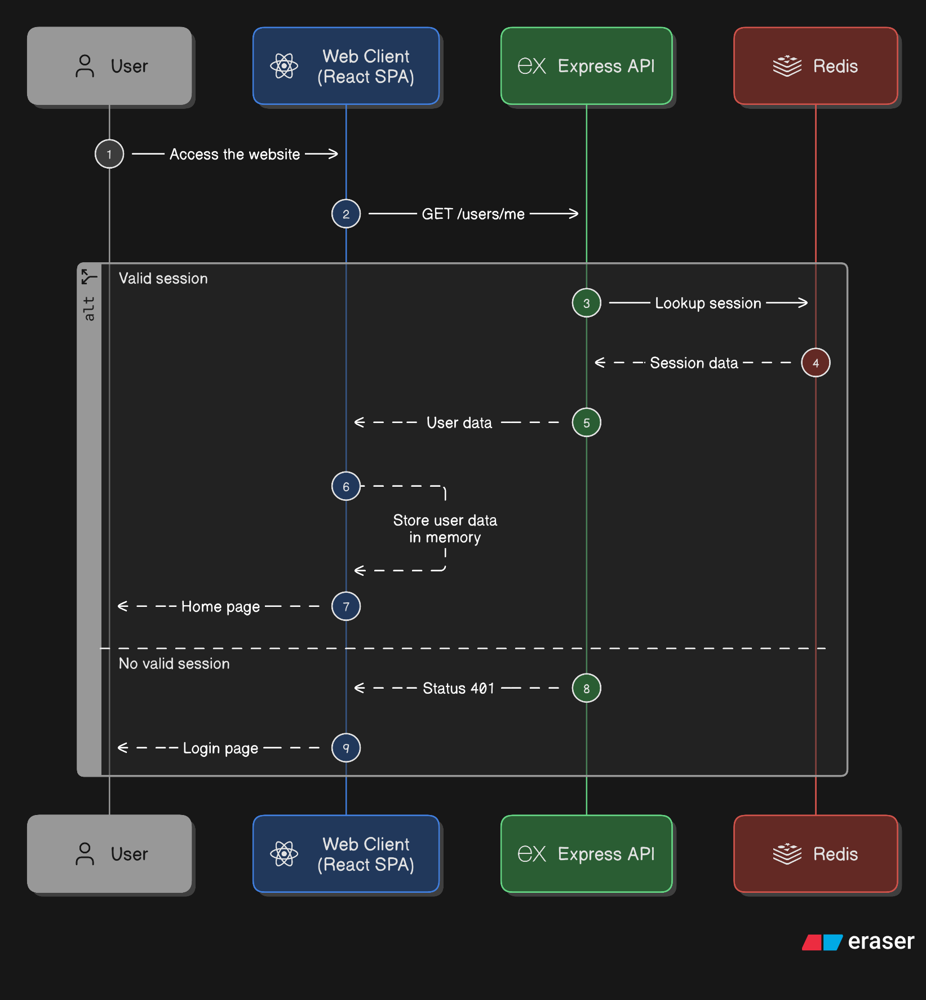
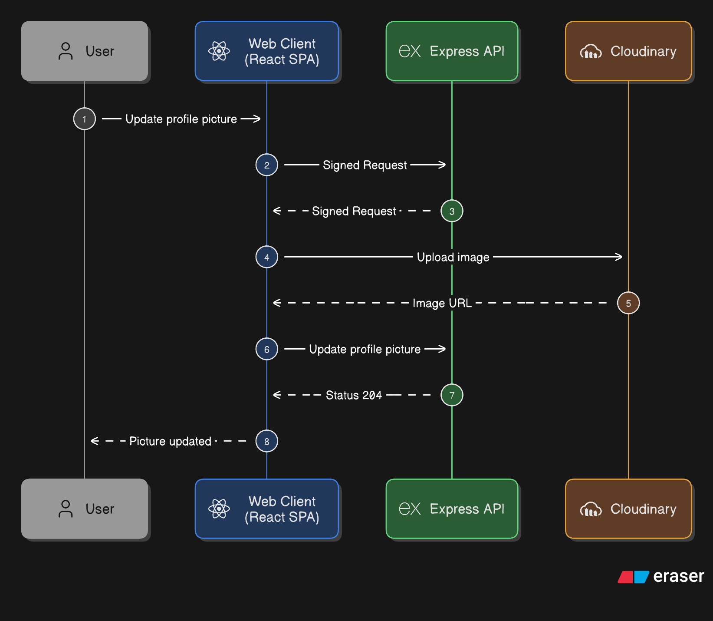

# Linku

Linku is a real-time chat application made with React and Express. It allows users to create an account, personalize their profile, search for other users, and chat with them in real-time.

## Features

### User Authentication

The app uses a session-based authentication system to manage user accounts, using the `express-session` library. When a user signs up, their user ID is stored in a Redis database, which returns a session ID, which in turn is encoded with a secret key and sent to the user's browser in an HTTPS-only cookie. This session ID is used to identify the user in subsequent requests.

  

Since the web app is a single-page application (SPA), it asks for the user data on the initial load (`GET /me` endpoint). Then the server decodes the cookie, gets the user ID from Redis and returns the user data, which the browser stores **in memory**.

> [!NOTE]
> This way, the user session isn't susceptible to XSS attacks, as JWT tokens stored in local storage would be.

  

### Profile Personalization

The most interesting aspect of profile customization is the profile picture. The app uses [Cloudinary](https://cloudinary.com/) to store images. When the user uploads a profile picture, the web app asks the server from a signed request to send to Cloudinary, which contains the API key and a signature. The server then stores a public image URL in the database. The same approach is used for message images.

This way, the server doesn't need to handle image uploads, and the API key is never exposed to the client.

  

---

Missing documentation:

- Search users
- Real-time messaging with others
