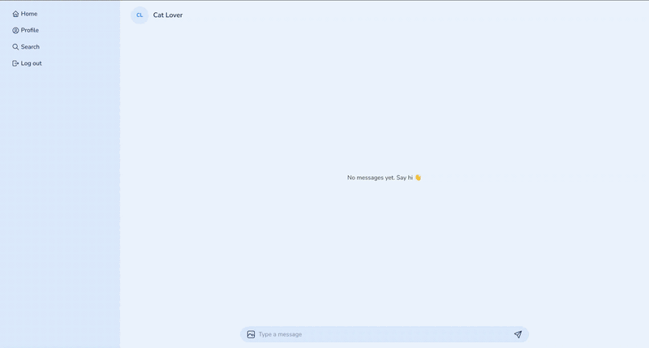

# Linku

[**Linku**](https://linku-web-eight.vercel.app) is a real-time chat application made with React and Express. It allows users to create an account, personalize their profile, search for other users, and chat with them in real-time.

## Main Features

### Real-time Chat

  

Users can send messages and images to each other. The app uses [Socket.IO](https://socket.io/) to handle real-time communication between the client and the server. When someone sends a message for the first time in a chat, the server stores a room ID. When the other user connects, they are added to the same room, if it exists, and both users are ready to chat in real-time.

Additionally, messages are loaded lazily. When a user opens a chat, only the last 20 messages are loaded. When the user scrolls up to the top, the next 20 messages are loaded, and so on. This is done using cursor-based pagination and the [Intersection Observer Web API](https://developer.mozilla.org/en-US/docs/Web/API/Intersection_Observer_API) to detect user scrolling.

### User Authentication

The app has a session-based authentication system to manage user accounts, using the [`express-session` library](https://www.npmjs.com/package/express-session). When a user signs up, their user ID is stored in a Redis database, which returns a session ID, which in turn is encoded with a secret key and sent to the user's browser in an HTTPS-only cookie. 
This session ID is used to identify the user in subsequent requests.

> [!NOTE]
> All of the authentication endpoints have a rate limiter to prevent brute-force attacks. The state of this rate limiter is stored in Redis.

  

Since the web app is a single-page application (SPA), it asks for the user data on the initial load (`GET /me` endpoint). Then the server decodes the cookie, gets the user ID from Redis and returns the user data, which the browser stores **in memory**.

> [!NOTE]
> This way, the user session isn't susceptible to XSS attacks, as JWT tokens stored in local storage would be.

  

### Profile Personalization

The most interesting aspect of profile customization is the profile picture. The app uses [Cloudinary](https://cloudinary.com/) to store images. When the user uploads a profile picture, the web app asks the server for a signed request to send to Cloudinary, which contains the API key and a signature. The server then stores a public image URL in the database. The same approach is used for message images.

This way, the server doesn't need to handle image uploads, and the API key is never exposed to the client.

  

